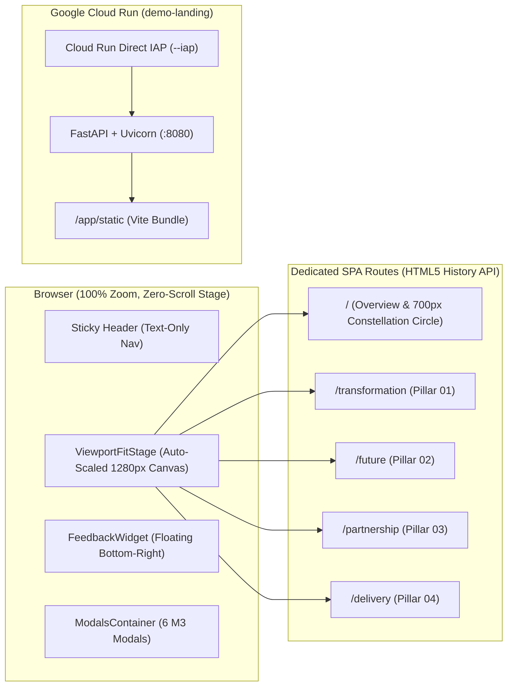

# Google Cloud × Cognizant Executive Digital Showcase (`demo-landing`) — Master Source of Truth

This document serves as the **single source of truth** for the **Google Cloud × Cognizant Executive Digital Showcase (`demo-landing`)** application—covering design origins, multi-page frontend architecture, interactive modals, strict UI/layout invariants, local development workflow, containerization, and Google Cloud Run + Identity-Aware Proxy (IAP) production deployment.

---

## 1. Executive Summary & Design Origins

- **Purpose**: An executive, presentation-grade digital showcase highlighting the **Google Cloud × Cognizant Strategic Alliance** across four strategic pillars:
  1. **Transformation Highlights** (`/transformation`) — *AI-Led Practices & Enterprise Transformation*
  2. **Future Roadmap** (`/future`) — *Future of Partnership & Joint Innovation*
  3. **Partnership Highlights** (`/partnership`) — *360° Partnership Value*
  4. **Delivery Highlights** (`/delivery`) — *Delivery Excellence & Client Value Creation*
- **Design System**: Material Design 3 (**Executive Light Mode**, surface `#FAF9FD`, primary `#0B57D0`, Google Sans / Inter / JetBrains Mono typography, animated 4-color Google brand borders).
- **Stitch Source of Truth**:
  - Stitch Project ID: [`16618768528408665144`](https://stitch.withgoogle.com/projects/16618768528408665144)
  - Primary Export Bundle: [`stitch_enterprise_ai_transformation_showcase (3).zip`](file:///home/user/projects/demo-landing/stitch_enterprise_ai_transformation_showcase%20(3).zip)
  - Archived HTML/PNG Reference: [`docs/stitch/designs/04-zip-export-v3.html`](file:///home/user/projects/demo-landing/docs/stitch/designs/04-zip-export-v3.html) and [`docs/stitch/designs/04-zip-export-v3.png`](file:///home/user/projects/demo-landing/docs/stitch/designs/04-zip-export-v3.png)
  - Design System Specification: [`docs/stitch/DESIGN.md`](file:///home/user/projects/demo-landing/docs/stitch/DESIGN.md)

---

## 2. Repository Directory Structure

```text
/home/user/projects/demo-landing/
├── README.md                                   # Master Source of Truth (this file)
├── Dockerfile                                  # Multi-stage build: Node 22 (Vite build) -> Python 3.12-slim (FastAPI + uv)
├── deploy.sh                                   # Automated Cloud Build + Cloud Run Direct IAP deployment script
├── .dockerignore                               # Excludes node_modules, .git, and zip archives from Docker context
├── .gcloudignore                               # Excludes local build artifacts during gcloud builds submit
├── backend/                                    # FastAPI static SPA server + health probe endpoint
│   ├── main.py                                 # Serves /api/health, /assets/*, and SPA history fallback -> index.html
│   └── pyproject.toml                          # Python dependencies (fastapi, uvicorn[standard]) managed via uv
├── docs/stitch/                                # Archived Stitch design specs & reference HTML/PNG exports
│   ├── DESIGN.md                               # Material 3 Light theme tokens, colors, and typography
│   ├── README.md                               # Stitch export inventory
│   ├── screens-index.json                      # Metadata for all screens in Stitch project 16618768528408665144
│   └── designs/
│       ├── 01-newsletter-base.html
│       ├── 02-executive-showcase-hub-light-m3.html
│       ├── 03-zip-export-newsletter-base.html
│       ├── 04-zip-export-v3.html               # Canonical v3 reference HTML from stitch_enterprise_ai_transformation_showcase (3).zip
│       └── 04-zip-export-v3.png                # Canonical v3 reference screenshot
└── frontend/                                   # React 18 + TypeScript + Vite + Tailwind CSS SPA
    ├── index.html                              # Loads Google Fonts (Google Sans, Inter, JetBrains Mono, Material Symbols Outlined)
    ├── package.json                            # Frontend dependencies & scripts (dev, build, preview)
    ├── tailwind.config.js                      # M3 color tokens, font families, and custom box shadows
    ├── vite.config.ts                          # Vite bundler configuration
    └── src/
        ├── main.tsx                            # React root mount
        ├── App.tsx                             # Top-level router, keyboard listeners, ViewportFitStage wrapper, FeedbackWidget, Modals
        ├── index.css                           # Keyframe animations, .google-animated-border, .hub-revolving-border, reveal classes
        ├── data/
        │   └── showcaseData.ts                 # Centralized route maps, quadrant metadata, modal types, and interactive datasets
        ├── hooks/
        │   ├── useDeviceType.ts                # Detects 'desktop' vs 'mobile' display mode (auto viewport/UA + ?device= override)
        │   └── useSequentialReveal.ts          # Presentation-style timed component reveal hook (1.35s–1.5s step interval)
        └── components/
            ├── mobile/
            │   └── MobileShowcaseView.tsx      # Dedicated Mobile-Friendly Showcase Display (320px dial, top/bottom nav, touch cards)
            ├── Header.tsx                      # Sticky top executive nav bar with text-only pillar links
            ├── ViewportFitStage.tsx            # ResizeObserver auto-scaling stage ensuring zero page scroll at 100% browser zoom
            ├── LandingBackgroundPattern.tsx    # Background theme selector (defaults to 'antigravity', supports '?bg=constellation' & '?bg=waves')
            ├── LandingBackgroundAntigravity.tsx # Active Default (v3): antigravity.google interactive morphing capsule particle wave field only
            ├── LandingBackgroundWaves.tsx      # Parked Version (v2): Google 4-color pastel silk waves pattern (?bg=waves)
            ├── LandingBackgroundConstellation.tsx # Parked Version (v1): Constellation nodes, dot-matrix & orbital rings (?bg=constellation)
            ├── HeroConstellation.tsx           # Landing page ('/'): 700x700px 4-quadrant circle + center hub disc + 3 bottom CTA cards
            ├── TransformationPillarSection.tsx # '/transformation' page: Pillar 01 content & interactive modal triggers
            ├── FuturePillarSection.tsx         # '/future' page: Pillar 02 content, GenAI Engine & Orchestrator preview
            ├── PartnershipPillarSection.tsx    # '/partnership' page: Pillar 03 content (360° Partnership Value)
            ├── DeliveryPillarSection.tsx       # '/delivery' page: Pillar 04 content (2x2 Delivery grid + right callout stack)
            ├── PresentationControls.tsx        # '↑ Back to Landing Page' navigation button on Pillar pages
            ├── FeedbackWidget.tsx              # Floating bottom-right circle button & Material 3 feedback popover form
            └── ModalsContainer.tsx             # Interactive executive deep-dive modals
```

---

## 3. Application Architecture & Multi-Page Routing

### 3.1 Architecture Diagram



### 3.2 Route Table & Navigation Flow

Routing is managed in [`App.tsx`](file:///home/user/projects/demo-landing/frontend/src/App.tsx) and [`showcaseData.ts`](file:///home/user/projects/demo-landing/frontend/src/data/showcaseData.ts) using the HTML5 History API (`window.history.pushState` + `popstate` listener), backed by FastAPI's SPA catch-all route in [`backend/main.py`](file:///home/user/projects/demo-landing/backend/main.py) so direct navigation or browser refresh works on any path:

| Page Route Key (`PageRoute`) | URL Path | Top Nav Label | Component Rendered | Reveal Steps (`useSequentialReveal`) |
|---|---|---|---|---|
| `'landing'` | `/` | `Overview` | [`HeroConstellation.tsx`](file:///home/user/projects/demo-landing/frontend/src/components/HeroConstellation.tsx) | Immediate interactive stage |
| `'transformation'` | `/transformation` | `Transformation` | [`TransformationPillarSection.tsx`](file:///home/user/projects/demo-landing/frontend/src/components/TransformationPillarSection.tsx) | 6 sequential steps — Row 1 (Left → Right), Row 2 (Left → Right), Row 3 (Left → Right) (`1350ms` interval) |
| `'future'` | `/future` | `Future Roadmap` | [`FuturePillarSection.tsx`](file:///home/user/projects/demo-landing/frontend/src/components/FuturePillarSection.tsx) | 5 sequential steps — Horizons 01–04 (Left → Right), then 5-Step Pipeline (`1350ms` interval) |
| `'partnership'` | `/partnership` | `Partnership` | [`PartnershipPillarSection.tsx`](file:///home/user/projects/demo-landing/frontend/src/components/PartnershipPillarSection.tsx) | 4 sequential steps — Left Alliance Card (1), then Right Cards (2 → 3 → 4) (`1350ms` interval) |
| `'delivery'` | `/delivery` | `Delivery Highlights` | [`DeliveryPillarSection.tsx`](file:///home/user/projects/demo-landing/frontend/src/components/DeliveryPillarSection.tsx) | 7 sequential steps — Row 1 Left-to-Right (1 → 2 → 3), then Row 2 Left-to-Right (4 → 5 → 6 → 7) (`1350ms` interval) |

---

## 4. Component & Feature Catalog

### 4.1 Sticky Executive Header ([`Header.tsx`](file:///home/user/projects/demo-landing/frontend/src/components/Header.tsx))
- Positioned as a non-overlapping flex item (`sticky top-0 z-50 w-full shrink-0`) at the top of the `h-screen` viewport column.
- Left: **Google Cloud × Cognizant** executive brand lockup (clicking navigates to `/`) + `Strategic Alliance Showcase` badge.
- Right: Text-only navigation pill bar (`Overview`, `Transformation`, `Future Roadmap`, `Partnership`, `Delivery Highlights`) — numeric prefixes (`01`–`04`) were intentionally removed per user direction.

### 4.2 Zero-Scroll Presentation Stage ([`ViewportFitStage.tsx`](file:///home/user/projects/demo-landing/frontend/src/components/ViewportFitStage.tsx))
- Wraps the active page inside a `1280px` natural desktop canvas and uses `ResizeObserver` on both the available `<main>` viewport area and the natural content height.
- Computes a uniform scale factor:
  $$\text{scale} = \max\left(0.45,\ \min\left(1,\ \frac{\text{availW} - 32}{1280},\ \frac{\text{availH} - 20}{\text{naturalH}}\right)\right)$$
- Guarantees that **every page fits 100% on screen without scrolling** at 100% browser zoom, while never clipping card text or distorting the circular geometry of the constellation dial.

### 4.3 Landing Page (`/`): Interactive Constellation Hub ([`HeroConstellation.tsx`](file:///home/user/projects/demo-landing/frontend/src/components/HeroConstellation.tsx)) & Ambient Google-Color Background ([`LandingBackgroundPattern.tsx`](file:///home/user/projects/demo-landing/frontend/src/components/LandingBackgroundPattern.tsx))
- **Headline**: *"Accelerating Enterprise Transformation Through AI & Delivery Excellence"* with compact subheadline.
- **Selectable Google-Color Background Themes**:
  - **Active Default (`'antigravity'` — [`LandingBackgroundAntigravity.tsx`](file:///home/user/projects/demo-landing/frontend/src/components/LandingBackgroundAntigravity.tsx))**: Renders exclusively on the first page (`activePage === 'landing'`, `/`) and unmounts on all Pillar pages (`/transformation`, `/future`, `/partnership`, `/delivery`). Replicates the `https://antigravity.google/` hero background animation — rendering ONLY the interactive 3D Simplex-noise morphing capsule particle wave field (`MainParticlesComponent` shader math in `#2c64ed` Blue, `#f84242` Red, `#ffcf03` Yellow, and `#34a853` Green) on the clean `#FAF9FD` surface (no synth haze or line borders), rippling around the central constellation and tracking pointer movement.
  - **Parked Version (`'constellation'` — [`LandingBackgroundConstellation.tsx`](file:///home/user/projects/demo-landing/frontend/src/components/LandingBackgroundConstellation.tsx))**: Preserved constellation nodes, dot-matrix flanks, S-curve dashed ribbons, and lateral orbital resonance rings (`?bg=constellation`).
  - **Parked Version (`'waves'` — [`LandingBackgroundWaves.tsx`](file:///home/user/projects/demo-landing/frontend/src/components/LandingBackgroundWaves.tsx))**: Preserved SVG wave ribbons (`?bg=waves`).
- **Interactive 4-Quadrant Constellation Circle (`700px × 700px`, $R = 350\text{px}$)**:
  - Outer circular frame with `rounded-full overflow-hidden`, subtle concentric SVG rings, and animated 4-color vertical/horizontal axis dividers (`.animated-axis-y`, `.animated-axis-x`) with pulsing intersection dots.
  - **Center Hub Disc (`#hub-center-disc`)**: `w-32 h-32` ($r = 64\text{px}$) revolving 4-color conic border (`.hub-revolving-border`) with official 4-color Google Cloud SVG icon and *"Google Cloud Center of Gravity"* label.
  - **4 Clickable Quadrants**:
    - Top-Left (`transformation`): `01 • TRANSFORMATION` — *AI-Led Practices & Enterprise Transformation*
    - Top-Right (`future`): `02 • FUTURE` — *Future of Partnership & Joint Innovation*
    - Bottom-Left (`partnership`): `03 • PARTNERSHIP` — *360° Partnership Value*
    - Bottom-Right (`delivery`): `04 • DELIVERY` — *Delivery Excellence*
  - Clicking any quadrant navigates directly to its dedicated page (`/transformation`, `/future`, `/partnership`, `/delivery`).
- **3 Bottom Executive CTA Cards**:
  1. `Strategic Focus` — *Transforming Together* (jumps to `/transformation`)
  2. `Scale & Execution` — *2,000+ Live Agents* (opens `modal-autonomous`)
  3. `360° Partnership` — *Value Reciprocity* (jumps to `/partnership`)

### 4.4 Pillar Pages & Sequential Reveal ([`useSequentialReveal.ts`](file:///home/user/projects/demo-landing/frontend/src/hooks/useSequentialReveal.ts))
- When a user opens any Pillar page, Step 0 (the section header & `↑ Back to Landing Page` button from [`PresentationControls.tsx`](file:///home/user/projects/demo-landing/frontend/src/components/PresentationControls.tsx)) appears immediately, and each subsequent component card smoothly transitions in one after the other from left to right, row by row (`.reveal-hidden` $\rightarrow$ `.reveal-visible`) every `1.35s` (`1350ms`). Never assign the same step index to two different cards on a page.
- All cards use the animated 4-color border class `.google-animated-border`.
- **Pillar Page Breakdown (Strict Left-to-Right, Row-by-Row Sequential Reveal)**:
  - **`/transformation` ([`TransformationPillarSection.tsx`](file:///home/user/projects/demo-landing/frontend/src/components/TransformationPillarSection.tsx)) — 6 Steps (`1..6`)**:
    - Row 1: Step 1 (Left: *Dedicated Google Cloud Transformation Office* + 5-Vector Prioritization Framework) $\rightarrow$ Step 2 (Right: *`$10M+` EPP ROI Delivered*).
    - Row 2: Step 3 (Left: *Scaling Agentic Solutions Across Cloud to Accelerate Speed to Deployment*) $\rightarrow$ Step 4 (Right: *`$10B+` TCV Supported*).
    - Row 3: Step 5 (Left: *E2E Architecture Leveraging Gemini Enterprise (GE)* + 5 Sub-Agents) $\rightarrow$ Step 6 (Right: *`40%` Engineering Spend Reduction Targeted*).
  - **`/future` ([`FuturePillarSection.tsx`](file:///home/user/projects/demo-landing/frontend/src/components/FuturePillarSection.tsx)) — 5 Steps (`1..5`)**:
    - Row 1 (Left $\rightarrow$ Right): Step 1 (*Horizon 01: Cloud Support*) $\rightarrow$ Step 2 (*Horizon 02: Hub Services*) $\rightarrow$ Step 3 (*Horizon 03: GTM Helpdesk*) $\rightarrow$ Step 4 (*Horizon 04: Cross-Applicability*).
    - Row 2: Step 5 (*5-Step Autonomous Workflow Pipeline*).
  - **`/partnership` ([`PartnershipPillarSection.tsx`](file:///home/user/projects/demo-landing/frontend/src/components/PartnershipPillarSection.tsx)) — 4 Steps (`1..4`)**:
    - Left Column: Step 1 (*Strategic Alliance Expansion: 18,000 Engineers & 55,000 Associates*).
    - Right Column (Top $\rightarrow$ Bottom): Step 2 (*Executive Endorsement*) $\rightarrow$ Step 3 (*Talent Accelerator: 100K $\rightarrow$ 200K*) $\rightarrow$ Step 4 (*Field Validation: -35% Costs*).
  - **`/delivery` ([`DeliveryPillarSection.tsx`](file:///home/user/projects/demo-landing/frontend/src/components/DeliveryPillarSection.tsx)) — 7 Steps (`1..7`)**:
    - Row 1 (Left $\rightarrow$ Right): Step 1 (*Support*) $\rightarrow$ Step 2 (*Hub Services*) $\rightarrow$ Step 3 (*Value Creation Passed to Clients*).
    - Row 2 (Left $\rightarrow$ Right): Step 4 (*CDE CoE*) $\rightarrow$ Step 5 (*Partner Programs*) $\rightarrow$ Step 6 (*Executive Keynote: 18 Custom Demos*) $\rightarrow$ Step 7 (*Partner Advisory*).

### 4.5 Interactive Deep-Dive Modals ([`ModalsContainer.tsx`](file:///home/user/projects/demo-landing/frontend/src/components/ModalsContainer.tsx))
All 6 Material 3 modals support backdrop click dismissal, `Escape` key dismissal, and interactive internal state:
1. `modal-ecosystem` — **Executive Ecosystem Architecture & Briefing Deck** (cross-pillar summary & quick jump links).
2. `modal-autonomous` — **Agent Foundry & Autonomous Engineering Deep-Dive** (interactive autonomy tier selector & live agent telemetry).
3. `modal-sales` — **Joint GTM & Commercial Velocity Engine** (industry vertical plays, `$2B` pipeline breakdown, workshop scheduling).
4. `modal-managed-services` — **AI-Native Managed Services & SRE Operations** (AIOps observability & self-healing metrics).
5. `modal-prioritization-framework` — **Interactive Use-Case Prioritization Matrix** (interactive ROI / feasibility threshold sliders & live filtering).
6. `modal-orchestrator` — **Multi-Agent Orchestrator Reference Architecture** (interactive 4-layer architecture inspector: Supervisor, Domain Sub-Agents, Enterprise MCP Tool Bus, Policy Guardrails).

### 4.6 Floating Collect Feedback Button & Form ([`FeedbackWidget.tsx`](file:///home/user/projects/demo-landing/frontend/src/components/FeedbackWidget.tsx))
- **Trigger (`#collect-feedback-btn`)**: Hovering circular button (`fixed bottom-4 right-5 z-50`) with a subtle pulsing ring, `rate_review` icon, and hover label pill (`Collect Feedback`).
- **Popover Form (`#feedback-popover-dialog`)**:
  - 5-star interactive rating selector (`Needs Work` to `Excellent`).
  - Topic/Section chip selector (`Overview`, `Transformation`, `Future Roadmap`, `Partnership`, `Delivery Highlights`, `General`) that automatically defaults to the user's current `activePage`.
  - Optional Name/Email field and required Feedback comments textarea.
  - Persists entries to `localStorage` under `demo_landing_feedback` and displays a confirmation state upon submission.

### 4.7 Device-Type Responsive Display (`useDeviceType.ts` & `MobileShowcaseView.tsx`)
- **Zero-Regression Separation of Desktop & Mobile Views**:
  - Rather than altering the desktop presentation components (`ViewportFitStage`, `HeroConstellation`, or the 4 desktop Pillar sections), [`App.tsx`](file:///home/user/projects/demo-landing/frontend/src/App.tsx) uses [`useDeviceType.ts`](file:///home/user/projects/demo-landing/frontend/src/hooks/useDeviceType.ts) to detect `'desktop'` (`>= 1024px`) vs `'mobile'` (`< 1024px` or mobile handset user-agent, or explicit `?device=mobile` / `?device=desktop` URL query parameter).
  - When `deviceType === 'desktop'`, the exact zero-scroll Desktop Presentation Stage is rendered untouched.
  - When `deviceType === 'mobile'`, [`MobileShowcaseView.tsx`](file:///home/user/projects/demo-landing/frontend/src/components/mobile/MobileShowcaseView.tsx) renders a dedicated mobile-first Material 3 experience featuring:
    - Sticky top header (`#mobile-header`) with full-width 5-pill navigation and `Ecosystem Hub` quick button.
    - Mobile-proportioned interactive 4-quadrant Constellation Circle (`320px × 320px`, `#mobile-constellation-dial`) with a `64px` center revolving Google Cloud disc (`#mobile-hub-center-disc`) + full-detail tappable Pillar cards below.
    - Dedicated mobile layouts for `/transformation`, `/future`, `/partnership`, and `/delivery` with zero horizontal overflow (`overflow-x-hidden`).
    - Fixed 5-tab thumb navigation bar (`#mobile-bottom-nav`) at the bottom of the screen, with [`FeedbackWidget.tsx`](file:///home/user/projects/demo-landing/frontend/src/components/FeedbackWidget.tsx) automatically offset above it (`bottom-20 right-3.5`).

---

## 5. Strict UI & CSS Guardrails (Do Not Regress)

When making future edits, preserve these verified invariants:

1. **Zero Page Scroll at 100% Browser Zoom**:
   - The root container in [`App.tsx`](file:///home/user/projects/demo-landing/frontend/src/App.tsx) must remain `h-screen w-screen overflow-hidden flex flex-col`, with `<Header />` as a `shrink-0` top bar and `<ViewportFitStage>` inside `<main className="flex-1 overflow-hidden flex flex-col">`.
2. **No Footer**:
   - The footer was intentionally removed from [`App.tsx`](file:///home/user/projects/demo-landing/frontend/src/App.tsx) to maximize vertical canvas space and maintain a clean presentation stage.
3. **No `Presenting / Show All / Replay` Controls on Pillar Pages**:
   - [`PresentationControls.tsx`](file:///home/user/projects/demo-landing/frontend/src/components/PresentationControls.tsx) must only render the `↑ Back to Landing Page` button.
4. **Text-Only Top Navigation Bar**:
   - Keep pillar buttons in [`Header.tsx`](file:///home/user/projects/demo-landing/frontend/src/components/Header.tsx) text-only (`Overview`, `Transformation`, `Future Roadmap`, `Partnership`, `Delivery Highlights`) without `01`–`04` numeric prefixes.
5. **Constellation Circle Geometry (`700px × 700px`)**:
   - In [`HeroConstellation.tsx`](file:///home/user/projects/demo-landing/frontend/src/components/HeroConstellation.tsx), keep the circle container at `w-[700px] h-[700px]` ($R = 350\text{px}$) with `p-4` quadrant cells and `pr-12 pb-12` / `pl-12 pb-12` / `pr-12 pt-12` / `pl-12 pt-12` inner axis offsets (`48px`).
   - *Why*: At `48px` offset, the inner corner is at $\sqrt{48^2 + 48^2} = 67.9\text{px} > 64\text{px}$ (clearing the `128px` center disc), while the outermost text/badge corner reaches at most $\approx 308\text{px} < 350\text{px}$ (leaving $>42\text{px}$ clearance from the curved circular border so `rounded-full overflow-hidden` never clips any text).
6. **Center Hub Disc Centering (`.hub-revolving-border`)**:
   - In [`index.css`](file:///home/user/projects/demo-landing/frontend/src/index.css), `.hub-revolving-border` must keep `position: absolute !important; top: 50% !important; left: 50% !important; transform: translate(-50%, -50%) !important;`. Never set `position: relative` on `.hub-revolving-border`, as that overrides Tailwind's `absolute` positioning and displaces the center disc outside the circle.
7. **4-Quadrant Rotating Conic-Gradient Card Borders (`.google-animated-border`)**:
   - In [`index.css`](file:///home/user/projects/demo-landing/frontend/src/index.css), `.google-animated-border` uses the exact 4-quadrant rotating `conic-gradient` (`#4285F4 0deg 90deg, #EA4335 90deg 180deg, #FBBC04 180deg 270deg, #34A853 270deg 360deg`) with `@keyframes googleBorderRotate` (`8s linear infinite`) on `::before` (`inset: -50%; width: 200%; height: 200%; z-index: -2`) and a `2px` inner mask on `::after` (`inset: 2px; background: #FFFFFF; z-index: -1`) matching [`04-zip-export-v3.html`](file:///home/user/projects/demo-landing/docs/stitch/designs/04-zip-export-v3.html).

---

## 6. Local Development & Verification Workflow

### 6.1 Prerequisites
- **Node.js**: v22+ (`npm`)
- **Python**: v3.12+ with [`uv`](https://github.com/astral-sh/uv) (optional for running the FastAPI wrapper locally)

### 6.2 Running the Frontend Dev Server (Hot Reload)
```bash
cd /home/user/projects/demo-landing/frontend
npm install
npm run dev -- --host 127.0.0.1 --port 5173
```
Open `http://127.0.0.1:5173` in your browser.

### 6.3 Production Frontend Build Check
Always verify TypeScript compilation and Vite bundling before deploying:
```bash
cd /home/user/projects/demo-landing/frontend
npm run build
```
This outputs the static production bundle to `/home/user/projects/demo-landing/frontend/dist`.

### 6.4 Running the Full FastAPI + Static SPA Server Locally
[`backend/main.py`](file:///home/user/projects/demo-landing/backend/main.py) automatically falls back to serving `../frontend/dist` when `/app/static` is not present:
```bash
cd /home/user/projects/demo-landing/backend
uv run uvicorn main:app --host 127.0.0.1 --port 8080
```
- Application UI: `http://127.0.0.1:8080/`
- Health Check Endpoint: `http://127.0.0.1:8080/api/health`

---

## 7. Production Deployment on Google Cloud Run (`gtm-cloud-helpdesk`)

### 7.1 Infrastructure & Security Configuration

| Resource / Setting | Value |
|---|---|
| **GCP Project ID** | `gtm-cloud-helpdesk` |
| **GCP Project Number** | `653428233292` |
| **Region** | `us-central1` |
| **Artifact Registry Repo** | `us-central1-docker.pkg.dev/gtm-cloud-helpdesk/demo-landing-repo` |
| **Container Image** | `us-central1-docker.pkg.dev/gtm-cloud-helpdesk/demo-landing-repo/demo-landing:latest` |
| **Cloud Run Service Name** | `demo-landing` |
| **Primary Service URL** | `https://demo-landing-653428233292.us-central1.run.app` |
| **Alternate Cloud Run URL** | `https://demo-landing-zh6nqzpdqq-uc.a.run.app` |
| **Health Check Path** | `/api/health` (HTTP 200 JSON `{"status":"ok","service":"demo-landing","project":"gtm-cloud-helpdesk"}`) |
| **Runtime Service Account** | `653428233292-compute@developer.gserviceaccount.com` |
| **Container Port / Resources** | Port `8080`, `512Mi` RAM, `1` vCPU, timeout `60s`, non-root user `appuser` (`uid=1000`) |
| **Authentication & Ingress** | `--no-allow-unauthenticated` + **Cloud Run Direct IAP** (`--iap`) |
| **IAP Service Agent** | `service-653428233292@gcp-sa-iap.iam.gserviceaccount.com` (`roles/run.invoker`) |
| **IAP Authorized Principals** | `domain:google.com` and `user:saisreekark@google.com` (`roles/iap.httpsResourceAccessor`) |

### 7.2 Container Build Architecture ([`Dockerfile`](file:///home/user/projects/demo-landing/Dockerfile))
1. **Stage 1 (`node:22-alpine AS frontend-builder`)**:
   - Installs `frontend/package*.json` dependencies and runs `npm run build` to produce `/app/frontend/dist`.
2. **Stage 2 (`python:3.12-slim`)**:
   - Copies `uv` binary from `ghcr.io/astral-sh/uv:latest`.
   - Creates non-root user `appuser` (`uid 1000`).
   - Installs FastAPI & Uvicorn via `uv sync --no-dev --no-install-project`.
   - Copies `backend/` to `/app` and `/app/frontend/dist` to `/app/static`.
   - Runs `uv run uvicorn main:app --host 0.0.0.0 --port 8080`.

### 7.3 One-Command Deployment ([`deploy.sh`](file:///home/user/projects/demo-landing/deploy.sh))
To build and deploy a new revision to Cloud Run with Direct IAP and IAM policies automatically enforced:

```bash
cd /home/user/projects/demo-landing
./deploy.sh
```

What [`deploy.sh`](file:///home/user/projects/demo-landing/deploy.sh) executes:
1. Ensures the Artifact Registry repository `demo-landing-repo` exists in `us-central1`.
2. Submits the container build to Google Cloud Build (`gcloud builds submit --tag us-central1-docker.pkg.dev/gtm-cloud-helpdesk/demo-landing-repo/demo-landing:latest`).
3. Deploys the `demo-landing` Cloud Run service with startup/liveness probes pointing to `/api/health`.
4. Enables Cloud Run Direct IAP (`gcloud beta run services update demo-landing --iap`) and binds `roles/run.invoker` (for the IAP service agent) and `roles/iap.httpsResourceAccessor` (for `domain:google.com` and `user:saisreekark@google.com`).

### 7.4 Useful `gcloud` Inspection & Operations Commands

- **Check active Cloud Run service status & latest revision**:
  ```bash
  CLOUDSDK_METRICS_ENVIRONMENT="datacloud.antigravity" gcloud run services describe demo-landing \
    --region=us-central1 \
    --project=gtm-cloud-helpdesk \
    --format="yaml(status.url,status.latestReadyRevisionName,status.traffic)"
  ```
- **Stream recent Cloud Run container logs**:
  ```bash
  CLOUDSDK_METRICS_ENVIRONMENT="datacloud.antigravity" gcloud run services logs read demo-landing \
    --region=us-central1 \
    --project=gtm-cloud-helpdesk \
    --limit=50
  ```
- **Grant IAP access to an additional user or group**:
  ```bash
  CLOUDSDK_METRICS_ENVIRONMENT="datacloud.antigravity" gcloud iap web add-iam-policy-binding \
    --resource-type=cloud-run \
    --service=demo-landing \
    --region=us-central1 \
    --member="user:colleague@google.com" \
    --role="roles/iap.httpsResourceAccessor" \
    --project=gtm-cloud-helpdesk
  ```

---

## 8. Future Enhancement Playbooks

### 8.1 Persisting User Feedback to a Backend Database (BigQuery / Firestore)
Currently, [`FeedbackWidget.tsx`](file:///home/user/projects/demo-landing/frontend/src/components/FeedbackWidget.tsx) stores submitted feedback in browser `localStorage` (`demo_landing_feedback`). To persist feedback server-side:
1. Add a `POST /api/feedback` endpoint in [`backend/main.py`](file:///home/user/projects/demo-landing/backend/main.py) (note: place all `/api/*` routes **above** the `@app.get("/{full_path:path}")` catch-all route).
2. Read the authenticated IAP user headers (`X-Goog-Authenticated-User-Email`, `X-Goog-Authenticated-User-Id`) automatically injected by Cloud Run Direct IAP.
3. Write the payload (`rating`, `category`, `name`, `comment`, `page`, `timestamp`, `iap_email`) to BigQuery or Firestore using the Cloud Run runtime service account.
4. Call `fetch('/api/feedback', { method: 'POST', ... })` inside `handleSubmit` in [`FeedbackWidget.tsx`](file:///home/user/projects/demo-landing/frontend/src/components/FeedbackWidget.tsx).

### 8.2 Updating Pillar Copy, Metrics, or Modals
- **Landing Page Circle & CTAs**: Edit [`HeroConstellation.tsx`](file:///home/user/projects/demo-landing/frontend/src/components/HeroConstellation.tsx).
- **Pillar Cards**: Edit [`TransformationPillarSection.tsx`](file:///home/user/projects/demo-landing/frontend/src/components/TransformationPillarSection.tsx), [`FuturePillarSection.tsx`](file:///home/user/projects/demo-landing/frontend/src/components/FuturePillarSection.tsx), [`PartnershipPillarSection.tsx`](file:///home/user/projects/demo-landing/frontend/src/components/PartnershipPillarSection.tsx), or [`DeliveryPillarSection.tsx`](file:///home/user/projects/demo-landing/frontend/src/components/DeliveryPillarSection.tsx).
- **Sequential Reveal Speed**: Adjust the `stepGapMs` parameter passed to `useSequentialReveal(totalSteps, stepGapMs)` at the top of each Pillar component (default `1350ms`–`1500ms`).
- **Interactive Modal Data**: Edit [`showcaseData.ts`](file:///home/user/projects/demo-landing/frontend/src/data/showcaseData.ts) and [`ModalsContainer.tsx`](file:///home/user/projects/demo-landing/frontend/src/components/ModalsContainer.tsx).
